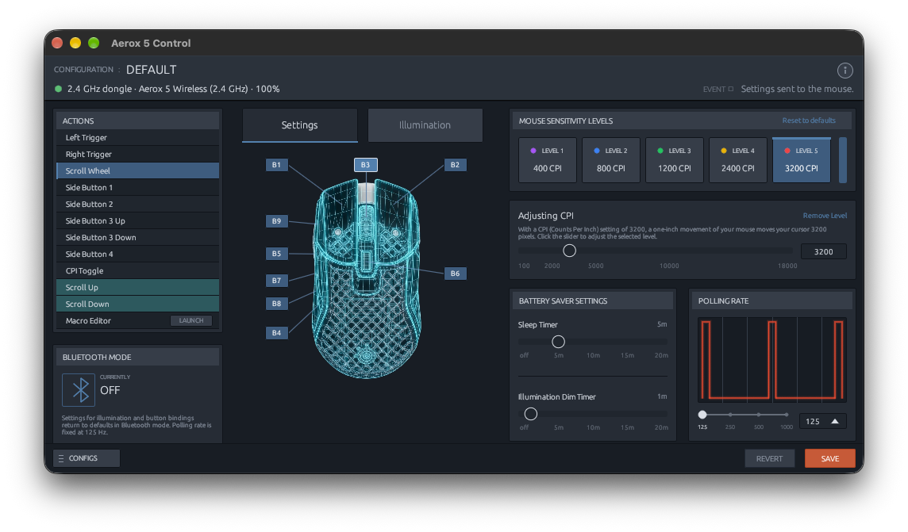
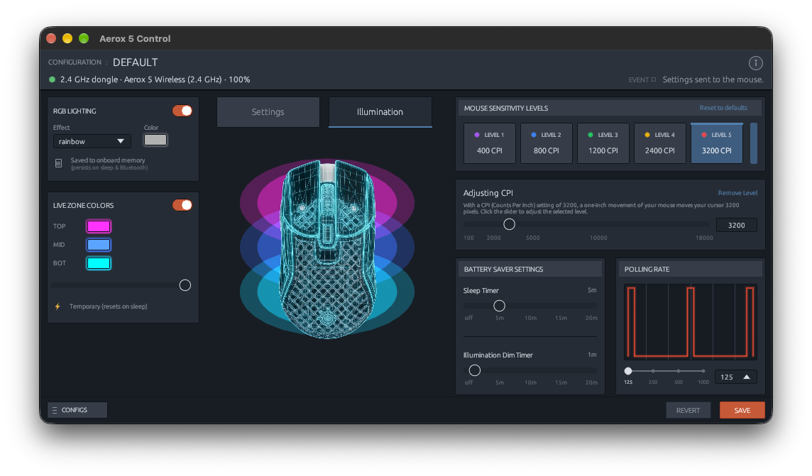

# Aerox 5 Control

A desktop app for configuring the **SteelSeries Aerox 5 Wireless** mouse. It gives you a simple
place to set sensitivity, polling rate, power-saving timers and RGB lighting without installing
SteelSeries GG, signing in to an account or connecting to the internet. The app saves your settings
on your computer and sends them to the mouse when you press **SAVE**.

It works with the Aerox 5 Wireless in wired (USB-C) mode and with its 2.4 GHz USB dongle, including
the Destiny 2 and Diablo IV editions. The app is designed and tested on macOS.

This app was created because SteelSeries GG does not support Apple Silicon Macs and is unlikely to
keep working in future versions of macOS. It gives Aerox 5 owners on macOS a way to configure their
mouse that does not depend on SteelSeries GG.



*The Settings tab: choose a button to highlight it on the mouse, and adjust sensitivity, timers and
polling rate on the right.*



*The Illumination tab: set the startup lighting effect, the colour of click reactions and the three
live lighting zones.*

## What you can do

- **Sensitivity (CPI):** keep up to five levels from 100 to 18000 CPI, pick the active one and edit
  levels with the slider. Values are snapped to the steps the mouse understands, levels sort
  themselves automatically and each level has its own indicator colour. `Reset to defaults`
  restores 400 / 800 / 1200 / 2400 / 3200 CPI.
- **Polling rate:** choose 125, 250, 500 or 1000 Hz. The little waveform illustrates the rate and
  smoothly changes shape when you pick a different one.
- **Power saving:** set how long the mouse waits before sleeping and before dimming its lighting,
  in half-minute steps up to 20 minutes.
- **Lighting:** switch RGB on or off, choose the effect the mouse uses when it wakes
  (`reactive`, `rainbow` or `reactive-rainbow`), set the colour of click reactions, and adjust the
  three lighting zones (`TOP`, `MID`, `BOT`) and their brightness. Live zone colours are temporary
  and reset when the mouse sleeps; the startup effect is saved on the mouse itself. When lighting
  is off, the app also clears the colours and reactions on the mouse.
- **Configurations:** save several named setups and switch between them from the `CONFIGS` window.
  You can create new ones and delete your own ones (`Default` cannot be deleted). The window shows
  the file being used, whether there are unsaved changes and any warnings about loaded settings.
- **SAVE and REVERT:** `SAVE` writes the active configuration to disk and then applies the settings
  to a connected mouse. If the file cannot be written, nothing is sent. `REVERT` only puts the
  values shown in the app back to the last saved ones; it changes neither the file nor the mouse.
- **Connection information:** the app detects when a mouse is plugged in or unplugged on macOS,
  shows the connection type and battery level in the header, and offers a `Refresh` button. Click
  the `EVENT` line for a timestamped list of everything that happened in the current session, or
  the round `i` button for device details such as product name, serial number and raw battery data.
  A wireless mouse may not answer immediately after connecting, so the app retries a few times.

Your configurations are stored in a JSON file at
`~/Library/Application Support/Aerox 5 Control/config.json` on macOS (or
`~/.aerox5-gui/config.json` elsewhere). Starting the app never creates or changes that file —
only `SAVE` and changes made in `CONFIGS` do.

## What is not supported

- **Button remapping, Bluetooth mode and the macro editor.** These appear in the interface for
  reference but are greyed out with an explanatory tooltip. The documented mouse protocol does
  not expose them, so the app does not pretend to change them.
- **Reading the current settings from the mouse.** The values shown in the app come from your saved
  configuration. The mouse has no documented way to report back its CPI levels, lighting or
  timers, so `SAVE` sends what you see rather than comparing it with the device.
- **Wireless power-off while the dongle stays plugged in.** macOS sees the USB receiver, not the
  radio link, so the app still shows the mouse as connected in that case.
- **Full support outside macOS.** The app can be built and run elsewhere, but automatic
  plug/unplug detection is macOS-only (use `Refresh` instead), and Windows HID reporting can
  prevent settings from being applied.

## Build and install

You need Rust (the repository pins the stable toolchain; see `rust-toolchain.toml`) and, for the
app bundle, macOS. On macOS no extra system libraries are needed — HID access uses IOKit.

Run the app directly from the source tree:

```bash
cargo run
```

To build a macOS app you can launch from Finder, run the packaging script from the repository
root:

```bash
./scripts/build-app.sh
```

It creates `dist/Aerox 5 Control.app`. Useful flags:

```bash
./scripts/build-app.sh --install   # copy the finished app to /Applications
./scripts/build-app.sh --open      # open it after building
./scripts/build-app.sh --no-sign   # skip ad-hoc code signing
./scripts/build-app.sh --help      # show all flags
```

The app is signed ad-hoc by default so macOS does not report it as damaged when you launch it
locally. To use your own icon, put a square PNG (preferably 1024×1024 or larger) at
`assets/AppIcon.png`; the script turns it into a macOS icon and embeds the same image in the app so
the Dock icon stays correct. `--open` refreshes macOS's icon registration; if the Dock still shows
an old icon, run `killall Dock` and add the app again. Packaging produces a signed `.app` bundle —
there is no DMG or other installer.

## Sources and credits

This app stands on the work of others. Thank you to:

| Project / crate | What it provided |
|---|---|
| [egui and eframe](https://github.com/emilk/egui) | The GUI toolkit and native window used for the interface. |
| [hidapi](https://github.com/libusb/hidapi) and [hidapi-rs](https://github.com/ruabmbua/hidapi-rs) | Talking to the mouse over USB HID. |
| [serde](https://github.com/serde-rs/serde) and [serde_json](https://github.com/serde-rs/json) | Reading and writing the configuration files. |
| [chrono](https://github.com/chronotope/chrono) | Timestamps in the event log. |
| [io-kit-sys](https://docs.rs/io-kit-sys), [core-foundation-sys](https://docs.rs/core-foundation-sys) and [libc](https://www.rust-lang.org/) | Detecting plug and unplug events on macOS. |
| [rivalcfg](https://github.com/flozz/rivalcfg/tree/189ff05f4022d58b9bac5cf388ad4a4b4892fc7f) | The main source for the reverse-engineered mouse protocol documented in `docs/com-spec.md`. |
| [SteelSeries GG](https://www.steelseries.com/gg) | Reference for how CPI values are presented (see `docs/steelseries-gg-cpi-analysis.md`) and for the original interface layout. |
| [BeautifulRust](https://github.com/morganlinton/BeautifulRust) | The lint configuration used to keep the code idiomatic. |

For how the application is put together, see `ARCHITECTURE.md`. For the low-level protocol
background, see `docs/com-spec.md`.
